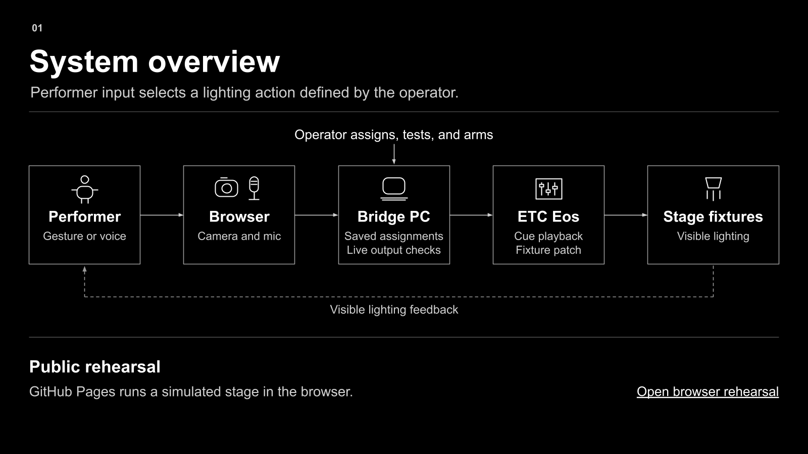
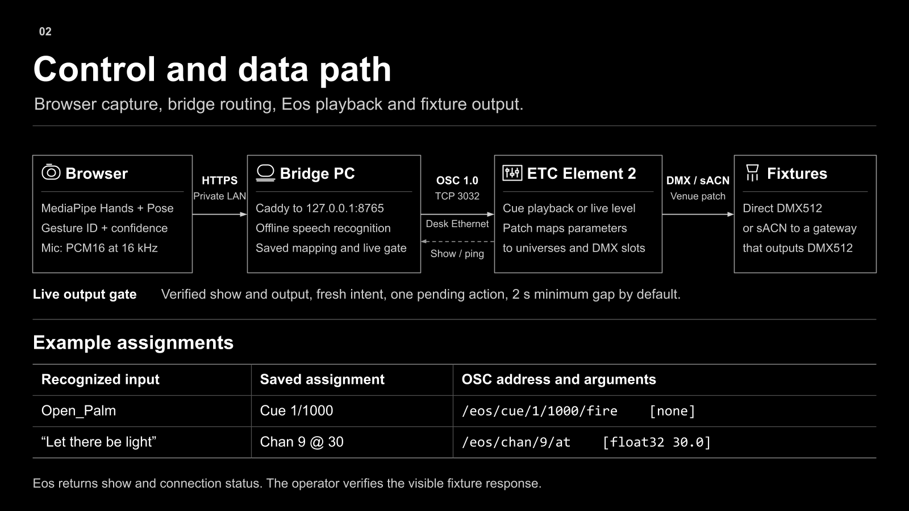

# Light Magic

Light Magic turns gestures and spoken phrases into lighting commands. I built it for [How to Make the Air Obey – Light Program](https://luluwangyy.github.io/lulu-wang-creative-tech-portfolio/projects/light-magic.html) at Barnard’s Movement Lab.

## Demo videos

- [Browser rehearsal](https://luluwangyy.github.io/lulu-wang-creative-tech-portfolio/projects/light-magic.html#rehearsal-demo) · A 30-second walkthrough of the rehearsal interface and simulated stage.
- [In-lab test 1](https://luluwangyy.github.io/lulu-wang-creative-tech-portfolio/projects/light-magic.html#in-lab-test-1) · A 14-second recording of Version 1 at the Movement Lab.

## Try it in your browser

Open the [browser rehearsal](https://luluwangyy.github.io/light-magic-site/try/) on a PC or Mac. Click **Open palm** to see the stage light up, then try **Fist** for a blackout. In the Speech panel, try typing “Let there be light” or “Stand down.” Start the camera to try palm and fist tracking. You can also use the microphone if your browser supports on-device speech recognition.

The preview simulates the Movement Lab’s lighting layout. It runs without an install or a console connection.

## System architecture

The camera and microphone feed gesture and speech recognition. The controller looks up the lighting action assigned to each match. In a live session, the Python bridge sends that action over OSC/TCP to ETC Eos. The console uses its fixture patch to control the stage lights.

## Use it with an ETC Eos console

For a live session, use a computer with the local controller installed and connect it to the console’s network.

1. Install Python 3.10 or later. On Windows, open **Start Movement Gesture.bat**. On macOS, run `sh "Start Movement Gesture.command"` from the controller folder.
2. For voice input, run the matching **Setup speech recognition** script and restart the controller. The setup needs internet access. Recognition runs offline afterward.
3. On the bridge computer, open `http://127.0.0.1:8765/` in Chrome or Edge. Choose camera, speech, or both in **Session**, then start a rehearsal to check recognition.
4. In **Cue sheet**, assign each trigger to an existing Eos cue or channel action. In **Console**, enter the desk’s IP address, TCP port, and OSC framing. Use **Test connection**, confirm the show, and verify each mapped output at the desk before choosing **Go live**. Press **Esc** or **Pause output** to stop new commands.
